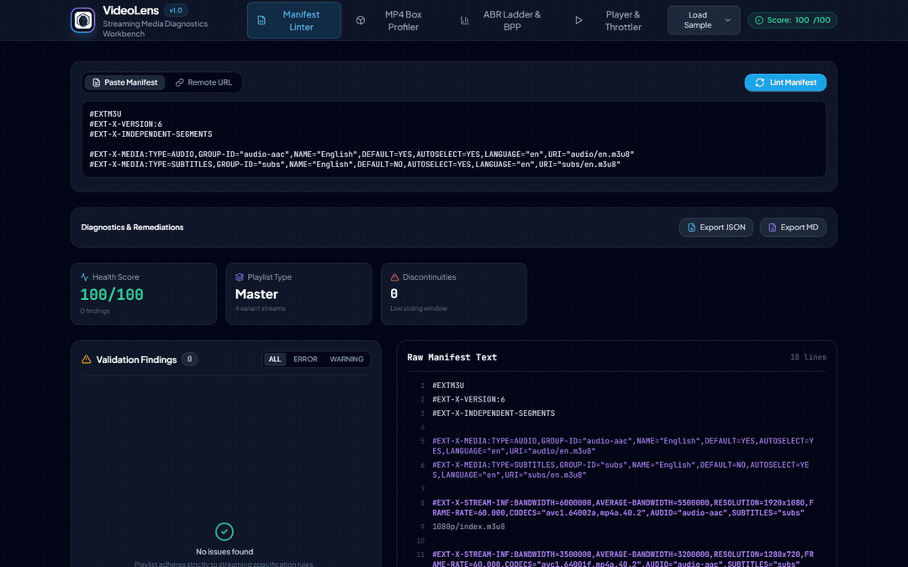
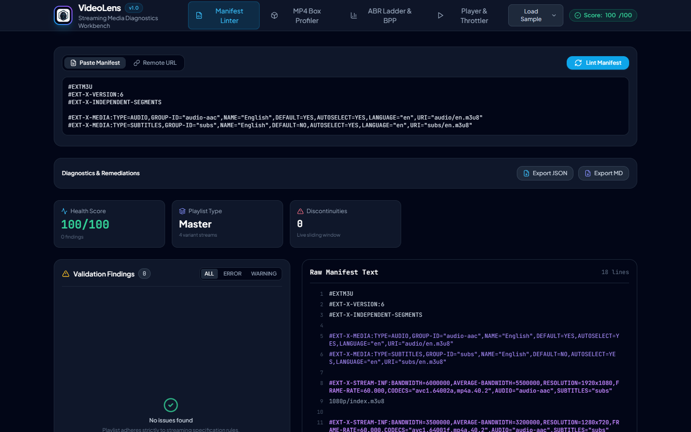
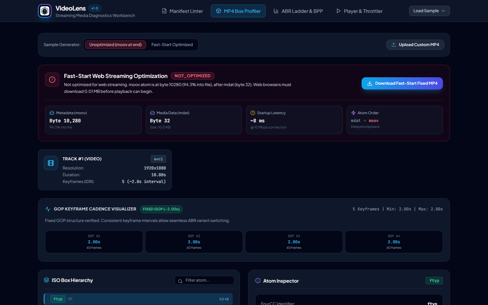
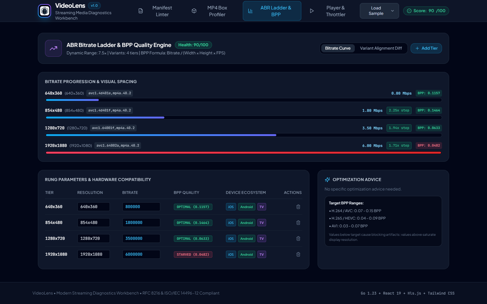
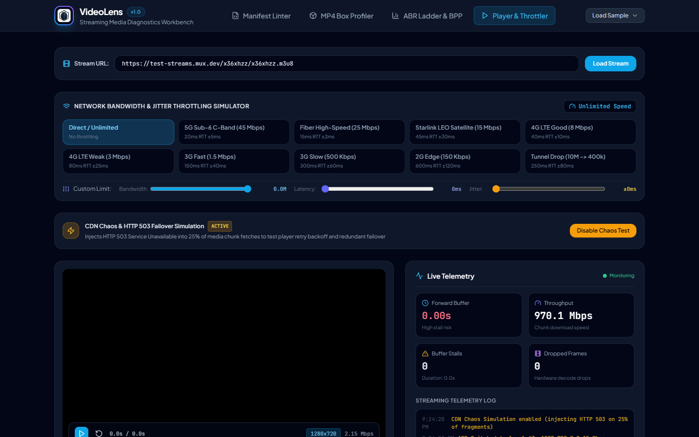

<p align="center">
  
</p>

<h1 align="center">VideoLens</h1>

<p align="center">
  <b>Streaming media diagnostics workbench, binary ISO MP4 box profiler, and ABR ladder validator</b>
</p>

<p align="center">
  <a href="https://go.dev/"></a>
  <a href="https://react.dev/"></a>
  <a href="LICENSE"></a>
  <a href="https://github.com/alexandrmotologa/videolens"></a>
</p>

VideoLens inspects HLS and MPEG-DASH streaming manifests, parses binary ISO Base Media File Format (ISOBMFF / MP4) atom trees, evaluates Fast-Start web streaming readiness with automatic offset remuxing, audits ABR bitrate ladders using Bits Per Pixel (BPP) calculations, and simulates adaptive player buffering under network throttling.

<div align="center">
  
</div>

### Interface Walkthrough

| Manifest Linter & RFC 8216 Validator | Binary MP4 Box Profiler & GOP Filmstrip |
|:---:|:---:|
|  |  |

| ABR Bitrate Ladder & Variant Alignment | Player Sandbox & Buffer Throttler |
|:---:|:---:|
|  |  |

---

## Capabilities

### 1. Binary MP4 Box and Atom Profiler
- Parses ISO/IEC 14496-12 box structures including `ftyp`, `moov`, `trak`, `mdia`, `minf`, `stbl`, `stsd`, `stts`, `stss`, `stsz`, `stco`, `co64`, and `mdat`.
- Evaluates Fast-Start readiness: verifies whether the metadata atom (`moov`) precedes the media data atom (`mdat`).
- Fast-Start remediation: relocates `moov` ahead of `mdat` and rewrites 32-bit (`stco`) and 64-bit (`co64`) chunk offset tables in memory.
- Extracts track codecs (`avc1`, `hev1`, `hvc1`, `vp09`, `av01`, `mp4a`), sample rates, keyframe cadence, and track dimensions.
- Supports 64-bit extended box sizes (`largesize`).

### 2. RFC 8216 HLS and MPEG-DASH Manifest Linter
- Lints master playlists and media playlists against RFC 8216 and RFC 8217 standards.
- Audits segment duration drift: flags variance and standard deviation across segment durations.
- Validates `#EXT-X-TARGETDURATION`: flags segments exceeding target duration thresholds.
- Audits continuity tags: identifies missing `#EXT-X-DISCONTINUITY` markers across codec, timeline, or sequence changes.
- Validates Low-Latency HLS (LL-HLS) playlists: parses `#EXT-X-PART`, `#EXT-X-PART-INF`, `#EXT-X-SERVER-CONTROL`, and `#EXT-X-PRELOAD-HINT` tags.
- Parses MPEG-DASH `.mpd` XML manifests: inspects `Period`, `AdaptationSet`, `Representation`, and `SegmentTemplate` structures.
- 1-Click M3U8 auto-fixer: corrects target duration mismatches, inserts missing `#EXT-X-ENDLIST` tags on VOD, normalizes floating-point drift, and exports clean playlists.

### 3. ABR Bitrate Ladder Validator
- Calculates Bits Per Pixel:
  $$\text{BPP} = \frac{\text{Bitrate}}{\text{Width} \times \text{Height} \times \text{FPS}}$$
- Evaluates codec efficiency against established BPP ranges for H.264, HEVC/VP9, and AV1.
- Analyzes step ratios between adjacent rungs (optimal 1.5x to 2.0x, flagging harsh jumps greater than 2.5x or redundant tiers under 1.3x).
- Detects inverted ladders where higher resolutions receive lower bitrates.
- Cross-variant alignment matrix: audits keyframe presentation timestamps (PTS) across variant tracks to prevent playback stalls during ABR switches.
- Hardware compatibility matrix: inspects H.264 profile and level constraints across Apple iOS, Android, Smart TVs, Roku, and desktop web.
- Computes an aggregate ABR Health Score (0 to 100) with remediation suggestions.

### 4. Player Sandbox and Network Throttle Simulator
- Embeds an Hls.js playback sandbox with forward buffer health telemetry.
- Tracks buffer length in seconds ($t_{\text{buffer}} = \text{buffered.end} - \text{currentTime}$).
- Logs rebuffering stalls, stall durations, and dropped frames.
- Built-in bandwidth throttle presets: 5G Sub-6 C-Band (45 Mbps), Fiber (25 Mbps), Starlink Satellite (15 Mbps with 30ms jitter), 4G LTE, 3G, and Edge.
- Jitter and latency injector: simulates variable network delay up to 150ms.
- CDN Chaos and failover testing: periodically injects HTTP 503 Service Unavailable into chunk downloads to test player retry backoff and redundancy failover.

---

## Architecture

```
+-----------------------------------------------------------------------------------+
|                                     VIDEOLENS                                     |
+-----------------------------------------+-----------------------------------------+
                                          |
        +---------------------------------+---------------------------------+
        |                                                                   |
+-------v-------------------------+                 +-----------------------v-------+
|    HLS & DASH Manifest Linter   |                 |    Binary MP4 Atom Profiler   |
|  * RFC 8216 M3U8 Playlist Parser|                 |  * ISO/IEC 14496-12 Box Parser|
|  * MPEG-DASH MPD XML Validator  |                 |  * ftyp, moov, trak, stbl, mdat|
|  * Target Duration Drift Audit  |                 |  * Fast-Start Remediation     |
+-------+-------------------------+                 +-----------------------+-------+
        |                                                                   |
        +---------------------------------+---------------------------------+
                                          |
                        +-----------------v-----------------+
                        |    ABR Ladder & Codec Validator   |
                        |  * Resolution Progression Curves  |
                        |  * Bits Per Pixel (BPP) Quality   |
                        |  * Step Ratio & Inversion Audits  |
                        +-----------------+-----------------+
                                          |
                        +-----------------v-----------------+
                        |   Buffer & Throttle Simulator     |
                        |  * Network Bandwidth Throttling   |
                        |  * Forward Buffer Gauge (Seconds) |
                        |  * Rebuffering Stall Telemetry    |
                        +-----------------+-----------------+
                                          |
                        +-----------------v-----------------+
                        |   Interactive Web Studio & CLI    |
                        |  * Collapsible Atom Tree View     |
                        |  * Manifest Syntax Highlighter    |
                        |  * Live Hls.js Playback Monitor   |
                        +-----------------------------------+
```

---

## Installation

### From Source
```bash
git clone https://github.com/alexandrmotologa/videolens.git
cd videolens
go build -o videolens ./cmd/videolens
```

### Pre-requisites
- Go 1.23 or newer
- Node.js 20+ (for building frontend web assets)

---

## Command Line Interface

VideoLens functions both as a standalone command line tool and an embedded web server.

### Start Web Studio Server
```bash
videolens serve --port 8850
```
Open `http://localhost:8850` in your browser.

### Inspect HLS or DASH Manifest
```bash
videolens check https://test-streams.mux.dev/x36xhzz/x36xhzz.m3u8
```

Inspect with structured JSON output or Markdown reporting for CI/CD pipelines:
```bash
videolens check --format json --fail-on error input.m3u8
videolens check --format markdown manifest.mpd
```

### Auto-Repair Malformed HLS Playlist
```bash
videolens fix broken.m3u8 -o compliant.m3u8
```

### Inspect Local or Remote MP4 File
```bash
videolens check input.mp4
```

### Remux MP4 to Fast-Start (Web Optimized)
```bash
videolens faststart input.mp4 -o optimized.mp4
```

### Validate ABR Bitrate Ladder
```bash
videolens abr https://test-streams.mux.dev/x36xhzz/x36xhzz.m3u8
```

---

## REST API Reference

| Endpoint | Method | Description |
|---|---|---|
| `/api/hls/lint` | `POST` | Validates raw or remote M3U8 playlist against RFC 8216 rules |
| `/api/hls/fix` | `POST` | Automatically repairs malformed M3U8 playlists and normalizes durations |
| `/api/dash/lint` | `POST` | Validates raw or remote MPEG-DASH `.mpd` manifest |
| `/api/mp4/inspect` | `POST` | Parses binary ISO MP4 atom tree and Fast-Start status |
| `/api/mp4/remediate` | `POST` | Remuxes uploaded MP4 file to Fast-Start (`moov` before `mdat`) |
| `/api/ladder/analyze` | `POST` | Calculates BPP and step ratios from variant stream definitions |
| `/api/ladder/align` | `POST` | Compares segment boundary and PTS keyframe drift across variants |
| `/api/samples` | `GET` | Returns built-in HLS, DASH, and MP4 test streams |
| `/api/proxy` | `GET` | CORS streaming proxy for testing external manifest URLs |

---

## License

MIT License. See [LICENSE](LICENSE) for details.
